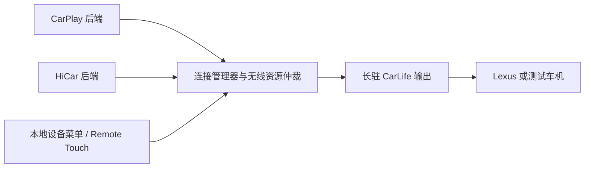

# CarPlay / HiCar 连接与设备菜单设计

2026-10-24，设计阶段。目标：H3 / 512 MiB、单 AX900/AIC8800、Linux，向车机保持有线 CarLife 输出，同时支持无线 CarPlay 或鸿蒙 4.2 HiCar。本文记录拟实施行为与验收条件；运行基线见 [HiCar 记录](hicar.md)和[验证记录](validation.md)。

## 设计结论

一个连接管理器选择手机；同一时刻一个手机拥有投屏和无线资源。已连接会话保持占用，用户主动选择优先。车机侧 CarLife 长驻，切换信源不重新枚举 USB。默认自动连接上次成功使用的手机，并提供固定首选、每次选择两种策略。

主要入口是 CarLife 画面内的 CarLink 设备菜单，支持 Lexus Remote Touch 焦点移动、按压确认和返回。实体按钮负责随时呼出菜单，网页作为维护入口。保留 `oemIconVisible=false`，CarPlay 桌面继续隐藏品牌图标。

## 调研依据

| 来源 | 已查到的行为或实现 | 对本项目的启发 |
| --- | --- | --- |
| [AAWireless 官方 FAQ](https://www.aawireless.io/en/support/topics-faq-aawireless/product-info) | 保存多台手机，实体按钮切换；TWO+ 支持 CarPlay / Android Auto | 保留一个稳定、独立于投屏软件的操作入口 |
| [Open Headunit 设置文档](https://headunit.andrerinas.com/guides/settings/) | 首选手机、上次手机、自动选择倒计时、每次询问 | 将选择策略显式化；等待期间可以在车机改选 |
| [AutoKit Link CH Pro 官方页](https://autokit.com/zh/products/79) | 商业产品同时支持 CarPlay 和 HiCar | 双协议产品形态已有参考；公开页面未给出内部仲裁实现 |
| [车连易 HiCar 自动连接 FAQ](https://cn.carlinkit.com/faq_detail/85.html) | 盒子自动连接与手机 HiCar 自动连接许可分别配置 | 免 PIN 认证、自动发现、手机允许自动连接分别验收 |
| [OpenXPlay 蓝牙源码，项目固定版本](https://github.com/OpenXPlay/OpenXPlay-Relay/blob/6a7cdab585113e29422f2306e90fdb5a789c318a/rust/direlay-linux/src/linux_bluetooth.rs) | 多个已绑定 iPhone 时要求指定 `--iphone ADDR`，配对有时间窗口 | 管理器必须明确选中手机；配对只在用户开启的窗口进行 |
| [OpenXPlay 管理接口源码，项目固定版本](https://github.com/OpenXPlay/OpenXPlay-Relay/blob/6a7cdab585113e29422f2306e90fdb5a789c318a/rust/direlay-linux/src/relay_admin.rs) | 模式切换先响应请求，再执行无线变更 | 网页操作先返回任务编号，进度交给车机菜单 |
| [aa-proxy-rs 蓝牙源码](https://github.com/aa-proxy/aa-proxy-rs/blob/main/src/bluetooth.rs) | 当前源码维护成功使用过的设备集合，重连不回退到所有蓝牙绑定设备 | 蓝牙配对与投屏成功分别记录；普通蓝牙设备不进入投屏候选 |
| [AAWireless 双手机论坛案例](https://www.reddit.com/r/AAWireless/comments/1ix9f2l/problem_with_auto_standby_and_two_phones_aaw2_a/) | 用户报告两台手机每 15–30 秒交替连接；帖子内维护者按故障跟进 | 将“当前连接不被另一台手机抢走”列为独立回归项 |

产品资料提供交互参考，开源代码提供实现参考，论坛案例用于补充故障场景。以下策略为 CarLink 的设计选择。

## 日常操作

菜单建议采用列表，首项显示当前手机与连接状态：

```text
当前：我的华为 · HiCar
连接：我的 iPhone · CarPlay
连接：我的华为 · HiCar
添加新设备 →
自动连接：上次使用 →
暂停自动连接
返回投屏
```

- 启动：显示连接进度和可选设备。普通单手机启动直接重连；“每次选择”策略停留菜单。自动选择可配置短倒计时，避免给所有启动强加等待。
- 投屏中：按钮短按呼出/收起菜单，移动焦点后确认目标；仅打开菜单时保留当前无线会话。
- 添加设备：进入子菜单选择 CarPlay 或 HiCar，再确认暂停当前会话，开放该协议的配对窗口。
- 返回：关闭菜单，恢复当前投屏；取消配对则尝试恢复原会话一次。
- 按钮长按约 3 秒：进入添加设备页面，仍需选择协议和确认。恢复出厂设置只放在设置中的明确确认流程。
- 原车快捷键：后续抓取 Remote Touch 原始事件，再选择可用的菜单呼出组合。现有事件会合成按下/抬起，需核实长按持续时间与 MENU / BACK 的实际传递情况。

首版先完成菜单和按钮入口；原车快捷键通过实车验证后再加入。网页仅在维护设备能访问当前热点或待机管理热点时使用，不要求 AX900 同时运行第二个热点。

### 典型场景

| 场景 | 默认行为 |
| --- | --- |
| 以前连接过的苹果、华为都在场 | 按策略先尝试上次成功手机或固定首选；一旦连接成功即保持 |
| 首选手机不在场 | 有界尝试后连接另一台可信手机；保留固定首选设置 |
| 当前华为已连接，苹果随后上车 | 华为继续使用；菜单可主动切换到苹果 |
| 当前苹果已连接，华为弹出连接提示 | 后端按当前选择拒绝抢占；通过 CarLink 菜单改选 |
| 两台同品牌手机 | 按持久化设备标识选择，支持自定义名称 |
| 添加新的苹果或华为 | 只开启所选协议的配对窗口，旧设备自动重连暂时挂起 |
| 添加超时、输错 PIN 或取消 | 显示原因，关闭配对窗口，恢复原手机一次或回到菜单 |
| 主动断开手机 | 本轮暂停该手机自动重连，直到用户选择恢复或新一轮使用开始 |
| 短暂掉线 | 先给原手机短暂恢复机会；超时后按策略回退 |
| 车机 USB 长期带电 | 根据 CarLife 会话存在与否进入待机；将电源状态与车机使用状态分别记录 |
| 目标手机要求解锁、权限或确认 | 菜单提示手机操作，保留当前目标，等待有界超时 |

普通蓝牙连接请求可能来自系统自动重连。主动切换意图以车机菜单、按钮或经过授权的管理请求为准。

## 设备记录与自动连接

每台设备分别保存：协议、稳定标识、显示名、蓝牙绑定状态、协议可信状态、成功投屏记录、自动连接许可、首选标志、最近稳定会话时间及私有密钥引用。名称和信号强度仅作显示与诊断。

“上次成功”在认证、网络、首帧和保活均正常并稳定一小段时间后更新。新设备只有蓝牙绑定成功时仍处于待完成状态。初期可保存 8 台设备，满额后由用户删除指定设备。

盒子的 MFi 身份、HiCar 持久化身份、蓝牙 MAC 和 HUKS 种子保持稳定。移除一台手机只撤销该设备的信任与自动连接资格。PIN 按设备固定，初次认证只在主动开放的配对窗口接受；日志和网页不导出私钥或配对数据。

首版策略：

1. **智能记忆，默认**：先尝试上次稳定使用的手机，再尝试其他可信手机。
2. **固定首选**：优先指定手机，不在场时允许回退；首选后来出现时保持现有连接。
3. **每次选择**：车机显示列表，用户确认后连接。

初始超时建议：配对窗口 120 秒；原手机掉线恢复 8 秒；单目标完整连接预算约 30 秒；后端停止预算 3 秒；稳定 10 秒后提交成功记录。数值通过台架数据调整。PIN 输入或权限确认阶段有单独提示和预算，避免后台不断更换目标。

## 软件结构与现有代码改造



管理器独占决策事件队列；无线管理器独占 AX900 热点、BlueZ 全局设置和默认配对代理。协议后端实现准备、限定目标连接、配对、停止、请求关键帧、健康状态等接口，退出时把资源交还管理器。

当前必须调整的具体位置：

- [receiver/supervisor.py](../receiver/supervisor.py)：当前任何一个子进程退出都会停止另一端。将 CarLife 输出与信源后端生命周期拆开，后端崩溃或切换时保留 USB 会话和菜单。
- [scripts/run-carplay.sh](../scripts/run-carplay.sh)：当前 OpenXPlay 直接管理热点。管理器显式传入目标 iPhone，并统一安排网络所有权。
- [experiments/hicar/network.py](../experiments/hicar/network.py)：当前实验会停整个 carlink，退出后恢复原配置并启动 carlink。生产路径改为领取/释放无线资源，移除自动恢复另一协议的副作用。
- 复用 [Remote Touch 输入抽象](lexus-remote-touch.md)：菜单消费方向、确认、返回；投屏期间交给当前后端。切换时释放尚未结束的按键。

状态包括等待车机、空闲、选择、配对、连接、活动、切换、恢复和待机；菜单显示作为活动会话上的独立状态。`selected_target` 与 `active_device` 分开保存。每次切换增加会话代号，媒体、控制、定时器和异步连接回调都校验代号，丢弃旧会话事件。

### 无线资源

首版只启用一个协议的完整连接服务和一个热点配置。CarPlay、HiCar 各用稳定的私有热点配置；选中后才启动对应服务、交付凭据。另一协议的首次配对广播关闭。BlueZ 的 discoverable、pairable、connectable 和 BLE 广告分别管理，避免仅关闭可发现却继续弹出 HiCar 提示。

保持适配器电源、MAC 与私有身份；配对安全策略只在对应窗口调整并恢复。候选探测也受选择锁约束，避免两个后端同时连接、修改热点或注册默认代理。后续如验证统一热点及并行被动发现可靠，再减少协议切换的网络开销。

目前真实手机免 PIN STS 已通过；完全无人操作的 HiCar 发现与自动重连、手机自动连接许可，以及 Lexus 菜单快捷键传递仍需独立验证。

### 切换事务

1. 接受并锁定明确目标，显示“正在切换到……”，暂停原手机自动重连。
2. 正常结束原协议媒体/控制会话，清空音频和输入状态；旧会话代号作废。
3. 停止旧协议发现与未完成连接，释放无线资源；保持 CarLife 和 Ethernet。
4. 配置目标协议热点与服务，只允许目标手机完成认证和媒体协商。
5. 收到目标媒体配置、关键帧及健康状态后切换输出，提交成功记录。
6. 失败时显示阶段与操作建议；按用户选择或默认策略回退原手机一次，随后停留菜单。重复切换请求串行处理。

本地菜单同样是视频生产者：同一时刻只有它或手机后端向 CarLife 输出视频。优先评估轻量原生绘制加预编码菜单画面，避免 H3 持续软件编码桌面。返回手机时请求新的参数集与 IDR，必要时重建媒体会话，防止使用菜单后的参考帧解码旧信源。呼出菜单可继续当前音频；实际切换则清空旧音频队列。

网页切换接口先返回任务编号再更改 Wi-Fi，进度由车机菜单显示。通话状态可获取后，为自动切换增加通话保护。待机、主动断开和故障恢复使用不同事件，防止“断开”立即触发重连。

## 单台华为同时作为 HiCar 信源和 CarLife 测试端

优先用现有设备尝试下列台架，降低对第二台手机的依赖：

```text
华为 HiCar 服务 --蓝牙 / Wi-Fi--> H3 接收与转发
华为 CarLife HU <--USB OTG----- H3 Type-C Device
电脑 ----------有线 SSH------> H3 Ethernet
```

华为通过 OTG 作为 USB 主机，AX900 留在开发板 USB-A。CarLife HU 前台显示输出，HiCar 保持无线会话。具体执行顺序：

1. 保存当前日志，正常结束会话；统一切换供电并确认唯一供电路径，CH340 的 5V 保持断开。使用手机 OTG 供电时控制测试时长；后续可选有明确供电隔离能力的带电源 OTG 方案。
2. 手机连接 HiCar，打开 CarLife HU，记录前后台切换对 HiCar 心跳、媒体服务和音频焦点的影响。
3. 依次验证静态画面、连续导航、方向/确认/返回回传、音乐、音乐加操作、暂停/恢复及重连。
4. 对照手机原始收流与 CarLife 输出的序号、时间戳和队列年龄，分开观察 HiCar、转发、USB 和 HU 解码。
5. 若同手机运行产生音频焦点竞争、回声、后台限制或服务中断，保留其结果用于输入/视频调试，音频稳定性改用独立 HU 对照。

手机加入盒子热点后，原局域网无线 ADB 地址可能改变。优先经有线 SSH 管理板子，再核实手机在当前热点的 ADB 可达性；测试链路建立不依赖原地址。HiCar 的虚拟显示与手机 CarLife Activity 的共存情况在第 2 步实测记录。

独立 HU 与实车用于最终验证：不同供电、USB 主机实现和真实 Remote Touch 均在对应环境验收。

## 实施与验收顺序

1. **HiCar → CarLife 桥接**：接入已验证的 H.264、AAC/PCM 和输入接口；先单手机台架，再独立 HU。保留队列年龄、丢帧、音频连续性与阶段耗时统计。
2. **生命周期与仲裁**：长驻 CarLife；加入设备记录、目标选择、无线独占、会话代号、正常停止和失败回退。先 CLI 自动化覆盖，再接 UI。
3. **设备菜单**：启动列表、添加、切换、取消与待机；接 Remote Touch 焦点输入，实体按钮呼出；之后实车确定原车快捷键。
4. **发现与自动重连**：验证 HiCar 自动连接许可和可信发现；覆盖多手机与常电待机，最后集成自启和固件。

关键回归：两手机以不同到达顺序同时出现；活动时另一台靠近；两台同品牌；配对错误/超时/取消；双向切换各 10 次；原手机在切换中抢连；目标离线回退；旧媒体回调晚到；仅手机一侧删除记录；Wi-Fi 关闭；锁屏等待确认；主动断开与短暂掉线；车机断开而电源保留；后端崩溃；全程触控板操作。记录 USB 枚举次数、RAM、队列、无线配置与凭据是否保留。

最终分层记录源码/自动化测试、完整 firmware job 与镜像校验上传、开发板运行、单手机/独立 HU 台架和 Lexus 实车结果。菜单和连接管理进入产品前，保留旧 CarPlay 配置及可回滚版本。
