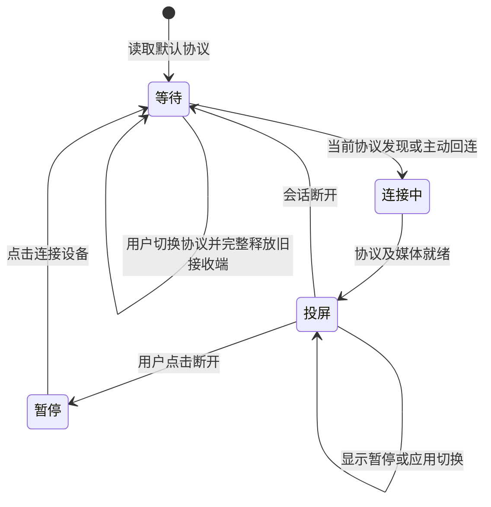

# 连接状态与菜单

本设计把 CarLife USB 会话、手机协议会话、视频显示状态分开管理。CarLife 常驻；切换 CarPlay/HiCar 只更换手机接收端。

## 当前交互

```text
返回投屏                         ← 已连接时第一行
当前协议：HiCar，点击切换到 CarPlay
断开 Huawei / 连接设备 / 配对中 · PIN：******
声音：50%                       ← 进入音量加减
默认协议：上一次选择
```

连接行随状态变化，配对码从本机私有身份文件读取。默认协议行依次切换华为 HiCar、苹果 CarPlay、上一次选择。未连接时隐藏“返回投屏”。Lexus 返回键单按正常转发；连续三按打开菜单；菜单内返回恢复投屏。

- 开机读取默认协议，立即启动该协议发现与回连，在菜单等待。
- 当前协议持久化；未找到手机时继续等待同一协议，另一协议的手机不抢连。
- 点击切换：停止旧进程组、清理无线连接及协议资源，启动另一协议。CarLife USB 保持。
- 点击断开：停止手机接收端，暂停自动连接，留在菜单。点击连接设备恢复，并开放当前协议配对窗口。
- 已配对 HiCar 手机除发现广播外，盒子还主动请求蓝牙连接；进入无线投屏后停止重复寻呼。
- 视频暂停、切应用、等待关键帧不等于手机离线；协议明确关闭或真实传输退出才回菜单。
- 手机离线后保留当前协议并重试；新会话使用新代次，旧事件不能关闭新会话。



## 可靠性规则

控制和音频 INIT/STOP 保持完整顺序。过期 PCM 可以丢弃，不能因为音频突发或正常角色切换关闭整个源 socket。已经部分写出的帧必须写完，避免破坏流边界。麦克风反向队列单独限制，不能占满触控和控制队列。故障源的本地 IPC 重建与物理 CarLife USB 会话隔离。

通话开始隔离普通媒体/导航与通话音频；通话结束重新建立当前媒体服务，不回放旧会话的积压。麦克风上行使用单调时间和采样时钟；协议会话变化清除旧重排、解码及采集代次。

## 来源与验证

华为官方说明首次鉴权后支持蓝牙/WLAN开启时自动无感连接：[HiCar简介](https://consumer.huawei.com/cn/support/content/zh-cn15947441/)、[无法自动回连](https://consumer.huawei.com/cn/support/content/zh-cn15833173/)。实现细节结合本地固定版本协议参考与实际手机日志。

自动测试覆盖协议粘性、默认协议、菜单按键、旧会话事件、显示暂停、音频压力和完整帧边界。当前台架与固件结果记录在 [validation.md](validation.md)，通话协议见 [calls.md](calls.md)。
